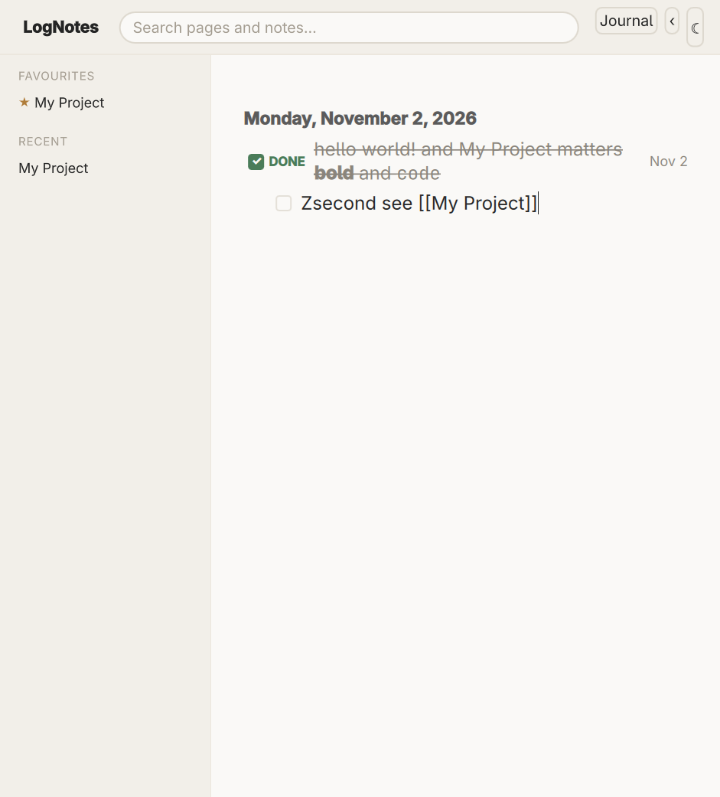

# LogNotes

A personal, trimmed-down rebuild of the Logseq 0.x workflow: a journal-first outliner with block
references, scheduled blocks and an agenda — as a native desktop app, on a local database.



Notes are blocks in a nested outliner on a journal day or a page. `[[brackets]]` and `#tags` link pages and
collect references; blocks carry `TODO` / `DOING` / `DONE` markers and a `SCHEDULED` date, so what is due
shows up on today's page. Markdown is rendered where it is read — bold, code, headings, links, mermaid
diagrams — and the block you are typing in stays plain text.

## What it does

- **Journal-first outliner.** A page per day, blocks typed and edited in place, indented and outdented from
  the keyboard. Empty days you never wrote in leave no trace.
- **Pages, links, tags, backlinks.** `[[Page]]` and `#tag` create and link pages; a page ends with its linked
  references and its plain mentions.
- **Tasks and scheduling.** A marker cycled by `Ctrl+Enter`, a `SCHEDULED` date by `Ctrl+Shift+S`, and what
  is due in the next week listed under today's blocks.
- **Markdown, rendered.** Bold, italic, code, headings, quotes, links, fenced code coloured by language and
  ```mermaid diagrams — in a block at rest; click it and you get the raw markdown, plain, to edit.
- **Search.** `Ctrl+K` puts the caret in the bar; typing searches page names and block text, `Ctrl+Enter`
  opens every match in a full results view.
- **A shell you can work from.** A sidebar of favourites and recently opened pages, a way back to the
  journal, and a light/dark theme that is remembered.
- **One local file.** Notes live in a single SQLite database; the app works fully offline, with no account.

## Status

Built for one person's daily use, and honest about it: Linux is where it is developed and tested; Windows
builds in CI. There is no sync, no plugin host, and no Markdown mirror — the database is canonical. Backup
and export exist so that staying put is a choice rather than a trap.

## Running it

Requires Rust (stable), Qt 6 with development headers, and a C++ toolchain (cxx-qt builds the bridge).

```bash
make run          # build and start the app
make build        # the app, debug
make release      # the app, release
make test         # every unit test
make livetest     # drive the real window through a scripted scenario, with screenshots
```

Without `make`:

```bash
cargo run -p lognotes-qt
```

Your notes live in `$XDG_DATA_HOME/lognotes/lognotes.db` (or `~/.local/share/lognotes/lognotes.db`), and on
Windows in `%APPDATA%\LogNotes\lognotes.db`. Deleting the file starts an empty graph; copying it is a
complete backup.

## How it is built

Two crates, and the edge between them is the rule:

- **`lognotes-core`** — the model, the SQLite store, sibling ordering, link extraction, the markdown
  scanner, the agenda query. Pure Rust, no Qt, testable with `cargo test` alone.
- **`lognotes-qt`** — the cxx-qt bridge, the journal model the QML binds to, the QML itself, and the two
  hand-written C++ shims.

The design rationale lives in the specs rather than in commit messages: [`goal-and-requirements.md`](goal-and-requirements.md),
[`architecture.md`](architecture.md), [`lognotes-core/SPEC.md`](lognotes-core/SPEC.md) and
[`lognotes-qt/SPEC.md`](lognotes-qt/SPEC.md).

## Licence

MIT — see [LICENSE](LICENSE).
