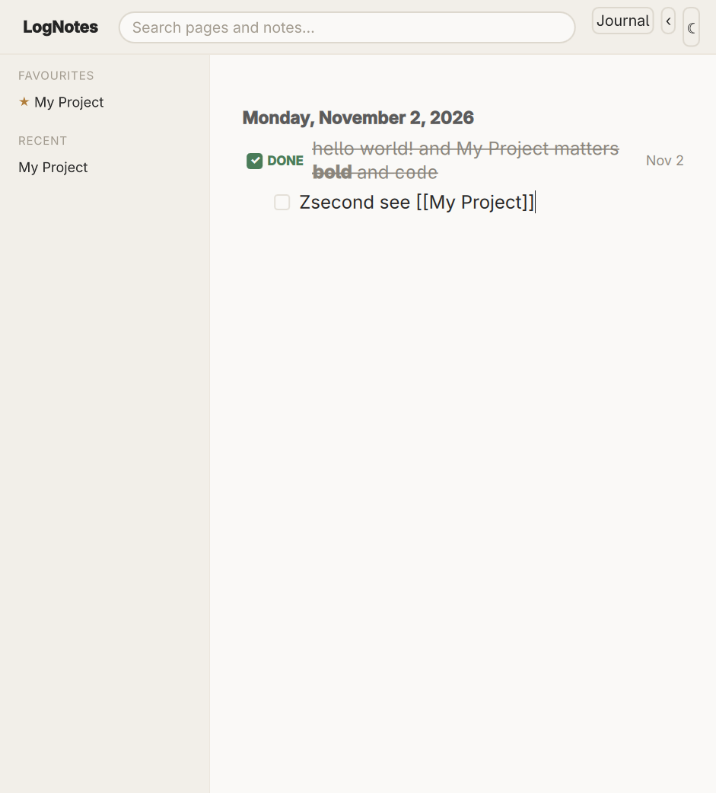

# LogNotes

A personal, trimmed-down rebuild of the Logseq 0.x workflow: a journal-first outliner with block
references, scheduled blocks and an agenda — as a native desktop app, on a local database.



Notes are blocks in a nested outliner on a journal day or a page. `[[brackets]]` and `#tags` link pages and
collect references; blocks carry `TODO` / `DOING` / `DONE` markers and a `SCHEDULED` date, so what is due
shows up on today's page. Markdown is rendered where it is read — bold, code, headings, links, mermaid
diagrams — and the block you are typing in stays plain text.

## What it does

- **Journal-first outliner.** A page per day, blocks typed and edited in place, indented and outdented from
  the keyboard. Empty days you never wrote in leave no trace. A Date control opens any day, written or not;
  blocks reorder with `Alt+Up`/`Alt+Down` and fold with the chevron beside them.
- **Pages, links, tags, backlinks.** `[[Page]]` and `#tag` create and link pages; a page ends with its linked
  references and its plain mentions. Pages can be renamed or deleted, and typing `[[` completes page names.
- **Tasks and scheduling.** A marker cycled by `Ctrl+Enter`, a `SCHEDULED` date by `Ctrl+Shift+S`, and what
  is due in the next week listed under today's blocks.
- **Markdown, rendered.** Bold, italic, code, headings, quotes, links, fenced code coloured by language and
  ```mermaid diagrams — in a block at rest; click it and you get the raw markdown, plain, to edit.
- **Search.** `Ctrl+K` puts the caret in the bar; typing searches page names and block text, `Ctrl+Enter`
  opens every match in a full results view.
- **A shell you can work from.** A sidebar of favourites and recently opened pages, a way back to the
  journal, and a light/dark theme that is remembered. Settings → About names the build version and platform.
- **One local file.** Notes live in a single SQLite database; the app works fully offline, with no account.
- **A memory for local agents.** While LogNotes is running, a loopback-only MCP bridge lets a coding agent
  read project context and write one project digest plus its tasks. The digest is a clearly marked section
  of the project page; tasks land in today's journal under an `[agent]` root. The app stays the only writer,
  and one undo takes the whole consolidation back.
- **Not locked in.** A daily backup beside the database (newest seven kept, plus "Back up now" and restore
  from any listed copy), and a Settings page that opens either folder in your file manager, exports the graph
  as the Markdown folder Logseq 0.x reads, and imports such a folder back in merge or replace mode.

## Status

Built for one person's daily use, and honest about it: Linux is where it is developed and tested; Windows
builds in CI. There is no sync, no plugin host, and no Markdown mirror — the database is canonical. Backup
and export exist so that staying put is a choice rather than a trap; import covers Logseq 0.x folders, not
Logseq 2's triple-store database (yet). The local agent bridge is an external companion, not a plugin
host: it exists only while the app runs, and it writes through the app.

## Downloading a build

[v0.1.0](https://github.com/fmanso/LogNotes/releases) — a Linux tarball (both binaries, `.desktop` entry,
icon) and a Windows zip that carries its Qt libraries and both executables, with `SHA256SUMS.txt` beside
them. Pushing a `v*` tag is what
publishes a release: CI builds both platforms and attaches them.

## Installing

On Linux, unpack the tarball and install the files it carries (the version in the names depends on the
release):

```bash
tar -xzf lognotes-0.1.0-linux-x86_64.tar.gz
install -Dm755 lognotes-0.1.0/lognotes-qt ~/.local/bin/lognotes-qt
install -Dm755 lognotes-0.1.0/lognotes-mcp ~/.local/bin/lognotes-mcp
install -Dm644 lognotes-0.1.0/lognotes.desktop ~/.local/share/applications/lognotes.desktop
install -Dm644 lognotes-0.1.0/lognotes.svg ~/.local/share/icons/hicolor/scalable/apps/lognotes.svg
install -Dm644 lognotes-0.1.0/README.md ~/.local/share/doc/lognotes/README.md
update-desktop-database ~/.local/share/applications 2>/dev/null || true
```

`~/.local/bin` has to be on `PATH` for the desktop entry's `lognotes-qt` and the agent client's
`lognotes-mcp`. On Windows, unpack the zip and run `LogNotes.exe`; it is portable, so there is nothing to
install. Windows may show a SmartScreen warning because the binary is unsigned. No AppImage, Flatpak, or
Windows installer is built for this release; a one-click installer waits for a code-signing certificate,
because an unsigned one adds no trust over the zip.

## Running it

Requires Rust (stable), Qt 6.8 or newer with development headers, and a C++ toolchain (cxx-qt builds the
bridge). The Linux tarball produced by `make dist` is linked against whatever Qt it was built with, so it
needs that version or newer on the machine that runs it; the Windows zip carries its Qt libraries.

```bash
make run          # build and start the app
make build        # the app, debug
make release      # the app, release
make test         # every unit test
make livetest     # drive the real window through a scripted scenario, with screenshots
```

Without `make`:

```bash
cargo run -p lognotes-qt
```

Your notes live in `$XDG_DATA_HOME/lognotes/lognotes.db` (or `~/.local/share/lognotes/lognotes.db`), and on
Windows in `%LOCALAPPDATA%\LogNotes\lognotes.db` (a v0.1.0 graph in `%APPDATA%\LogNotes` is moved there once,
with its backups, on first launch). Deleting the file starts an empty graph; copying it is a complete backup.
A `lognotes.log` sits beside it: the build version, platform, data path, and what startup did; it rotates at
1 MiB and keeps three files.

## Using it with an agent

LogNotes can act as the durable, human-readable memory for a local coding agent. The app exposes a
loopback-only bridge while it is running; `lognotes-mcp` is a thin MCP adapter over that bridge. The agent
never opens the database, and the app remains the only writer.

An opencode configuration looks like this (Claude Desktop uses the same `command` under `mcpServers`):

```json
{
  "mcp": {
    "lognotes": {
      "type": "local",
      "command": ["lognotes-mcp"],
      "enabled": true
    }
  }
}
```

The tools are `get_project_context`, `apply_project_consolidation`, `search_notes`, `get_page`, `get_day`,
`get_agenda`, and `get_backlinks`. `apply_project_consolidation` is the only write tool: it replaces the
`## Agent digest (auto-generated)` subtree of a named project page and adds or closes tasks under an
`[agent] … tasks` root on today's journal. It is one undo step. The app must be running; if it is not, the
tools say so.

`get_project_context` reads the explicit journal blocks that link the project, with their children and
ancestor framing, plus the project page's digest and human notes. Plain mentions and `[agent]` task
subtrees are not sources. The app refuses a write while a block editor is active (`editor_busy`), so an
agent cannot reset the model under unsaved text; click outside the block and retry. The whole consolidation
is one undo step.

No network endpoint is involved: the bridge is `127.0.0.1` with a per-launch token in
`lognotes-agent.json` beside the database. The file is user-only, and the token is never logged.

## How it is built

Three crates, and the edges between them are the rule:

- **`lognotes-core`** — the model, the SQLite store, sibling ordering, link extraction, the markdown
  scanner, the agenda query, and project consolidation. Pure Rust, no Qt, testable with `cargo test` alone.
- **`lognotes-qt`** — the cxx-qt bridge, the journal model the QML binds to, the QML itself, the local agent
  control server, and the one hand-written C++ shim that drives the window under the test-only `driver`
  feature.
- **`lognotes-mcp`** — the stdio MCP adapter. It speaks the agent's protocol, reads the app's control file,
  and forwards requests over loopback. It never links Qt and never opens the database.

The behavior contracts live in [`openspec/specs/`](openspec/specs/); the design rationale lives in
[`goal-and-requirements.md`](goal-and-requirements.md), [`architecture.md`](architecture.md),
[`lognotes-core/SPEC.md`](lognotes-core/SPEC.md) and [`lognotes-qt/SPEC.md`](lognotes-qt/SPEC.md). The two
are kept consistent: a module document may explain why, but it may not claim behavior the specs deny.

## Licence

MIT — see [LICENSE](LICENSE).
