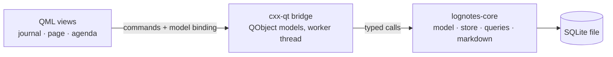

# LogNotes architecture

How the goal in `lognotes` is met: a Rust core owning the data, a thin Qt/QML layer owning the screen,
and one SQLite file as the only source of truth.

## Drivers

- **The database is canonical** (`lognotes`): every read and write goes through the store; there is no
  Markdown mirror, no second copy to reconcile.
- **The UI must not be able to corrupt the model.** Block order, page ownership, and derived indexes are
  the core's business; the interface only sends commands.
- **Windows and Linux from one tree**, with no platform-specific code paths.
- **Small enough to own.** Every layer here has to be one a single person can hold in their head, so the
  number of moving parts stays minimal — no server, no sync engine, no plugin host.

## Shape



Two crates enforce the boundaries — the crate edge *is* the rule:

- **`lognotes-core`** — pure Rust: block/page model, SQLite store, tree ordering, link extraction, the
  agenda query. No Qt types, so its logic is testable with `cargo test` on a machine with no Qt installed.
- **`lognotes-qt`** — the cxx-qt bridges (QObjects exposed to QML), the QML resources, and the binary.
  The only crate that links Qt.

QML never sees SQL, rusqlite types, or a database handle: it binds to models the bridge exposes and calls
commands on them. Core never sees QML. Anything the UI needs computed is a named query in core, not a
filter written in QML.

## Decisions

**Pages and blocks stay two kinds of thing.** One `page` row owns an ordered tree of `block` rows; a block
belongs to exactly one page. Logseq 2.x unifies them into nodes, and that unification is part of what the
maker walked away from — pages have names, journals have dates, blocks have parents, order, a task marker,
and a scheduled date. Keeping them separate keeps each table honest.

**Block order is a fractional key, not an integer.** A sibling holds a sortable text key between its
neighbours, so insert, indent, and move rewrite one row instead of renumbering the remaining siblings.
The cost — key growth on repeated mid-inserts — is invisible at personal-note scale.

**Links are derived, never authored.** On every block write, core extracts `[[page]]` and `#tag`
references into a link table and creates pages that don't exist yet. A block's text is the only truth
about what it links to; the link table can be dropped and rebuilt from it at any time.

**Markdown is read from the text, never stored beside it.** One scanner in core turns a block's text into
styled spans, links and fences. A block at rest draws them as escaped HTML — marks gone, links live — and
clicking it swaps in a plain-text editor: one weight, one colour, one size, the marks visible as the
characters they are. Styling is therefore something only the *reader* sees, which keeps the editor exactly
as inert as it was before markdown existed — no character formats to fight the caret or the undo stack —
and the click that switches forms is translated from a caret in the rendered text back to the raw one
rather than guessed.
The rejected alternatives are what make this the decision it is — a rich-text document, or a second
styled copy of the text, would each give the app two truths about a block that can drift apart, and put
the caret and the saved text at the mercy of a renderer.

**Search is a query, not a screen.** The quick switcher asks core for pages whose name matches and blocks
whose text does; the ranking — exact name, then prefix, then FTS5's bm25 over the one full-text index —
lives beside the data, and the view only draws the rows. That index was already there for plain mentions,
so search added a query rather than a second way to look at the graph.

**A diagram is derived data with a name.** A ```mermaid fence is rendered to SVG on the worker thread and
cached in the OS temp directory under a hash of its own content, so a snapshot — which happens after every
edit anywhere — redraws nothing that has not changed, and a wiped cache costs one redraw.

**One background worker thread owns the connection.** The bridge marshals every command to it and hands
the UI an immutable snapshot of rows. This keeps the GUI thread off the disk, and gives a single writer,
which removes the multi-writer contention that a UI thread plus background jobs would otherwise create.
Snapshots are cheap because a journal page is one page's rows, not the graph.

As built, a command travels QML invokable → channel → worker; the worker applies it, re-reads the loaded
days, and posts the rows back with Qt's own thread marshalling before the model is touched. Every command
answers with a full snapshot rather than a delta — at personal scale the difference is a few hundred rows,
and it removes any chance of the view drifting from the store. The concrete model surface lives in
`lognotes-qt`.

**The tree reaches QML flattened.** Views bind to a flat row list carrying a depth field rather than a
nested QObject tree: one model type serves the journal, a page, and the agenda, and QML renders a list
with indentation instead of recursing.

**Agenda is a page section, not a separate screen.** Today's journal page renders, in order: the day's
blocks, then the scheduled section, then linked references. Core supplies the scheduled blocks — a query,
not a view concern — so the same list can later appear elsewhere without reimplementing the rule.

## Invariants

- A block has exactly one owning page; nesting is a tree within that page and never crosses pages.
- Block text is canonical for links; the link table is derived and rebuildable from it.
- What a block looks like is derived from its text: styling never changes a character, and a diagram is
  named after the content that produced it, so both can be thrown away and recomputed.
- `scheduled_date` is a calendar date in local time, never a timestamp with a timezone — "the 14th" means
  the 14th wherever the laptop is.
- A block whose marker is `DONE` never appears in the scheduled section.
- The scheduled section lists non-`DONE` blocks with a scheduled date up to 7 days ahead, and keeps past
  dates listed as overdue until they are marked `DONE`. *(The 7-day horizon and the overdue rule are
  unconfirmed inferences from the maker's wording, recorded the same way in `lognotes`.)*
- Only the worker thread touches the connection; the UI holds snapshots, and never a handle to the data.
- A view never renders note rows before the store has opened: an unreadable database shows an error, never
  an empty journal.
- The database file is the only persistent state; deleting it loses nothing that exists elsewhere,
  because nothing else exists.

## Storage

SQLite through `rusqlite`, in WAL mode, one connection owned by the worker thread. Schema changes are
versioned with `PRAGMA user_version` and applied on open, so an older file is migrated upward in place
rather than rejected. Full-text search (FTS5) backs the plain-mention half of linked references; like the
link table, it is an index over block text rather than data in its own right.

The file lives in the OS application-data directory — `$XDG_DATA_HOME/lognotes` on Linux,
`%APPDATA%\LogNotes` on Windows — so it survives reinstalls and is easy to back up by copying one file.
This is the only OS-specific surface in the codebase.

## Packaging

One source tree builds both targets: cargo drives the build, cxx-qt generates the C++/Qt glue, and Qt 6
plus a C++ toolchain are build-time requirements on both platforms. Qt is linked dynamically, both for
the LGPL terms and because the system Qt on Linux is a shared library. Diagrams add one deployment
requirement: Qt's SVG image plugin, without which a drawn diagram silently renders as nothing.

## Out of scope

The following are absent by decision, not yet to be built: importing an existing Logseq 0.x graph,
exporting the database back to Markdown, sync between devices, plugin hosting, and the 2.x features the
maker does not use (queries, properties, graph view, whiteboards, flashcards). An export path is recorded
as open in `lognotes` — it is the one gap the canonical-database choice creates.
